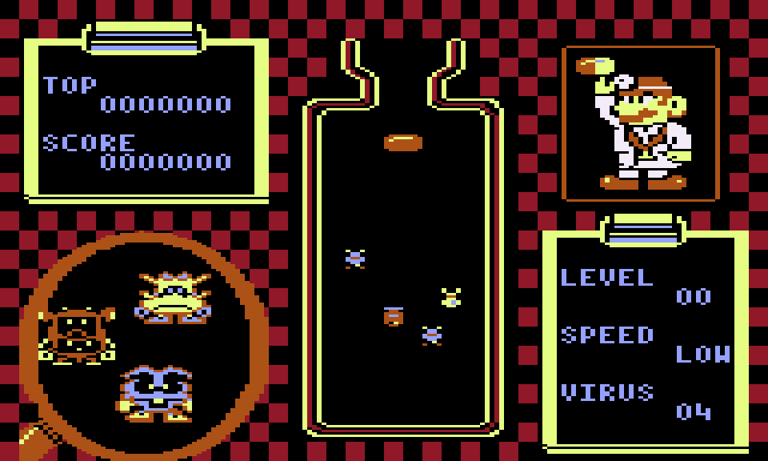
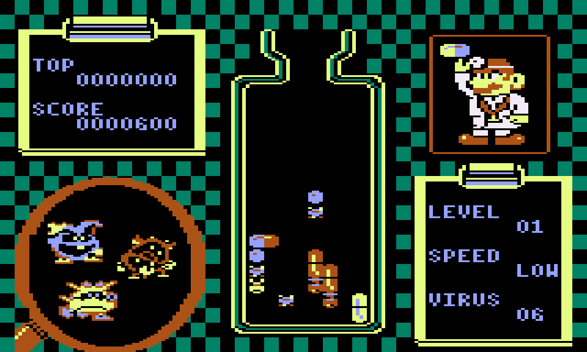

# Dr. Mario 99

Dr. Mario like never before: a free multiplayer battle in your browser.

**[Play now](https://dr-mario99.onrender.com/?ref=github)**

- **TV Room:** put it on a TV and up to 20 people scan a QR code. Their phones become the controllers, with no app or sign-up. Teams and CPU players too.
- **Multiplayer:** make a room for up to 8, or jump into Free Play.
- **Single player:** with the keyboard, your phone, or a Nintendo Switch Pro Controller.

Clear your viruses to send junk to your opponents. Clear them all first, or be the last one standing, to win.

Started from [rubikon02's Dr. Mario clone](https://rubikon02.github.io/projects/dr-mario).

Unofficial fan project. Not affiliated with or endorsed by Nintendo. Dr. Mario is a trademark of Nintendo.

## Screenshots

